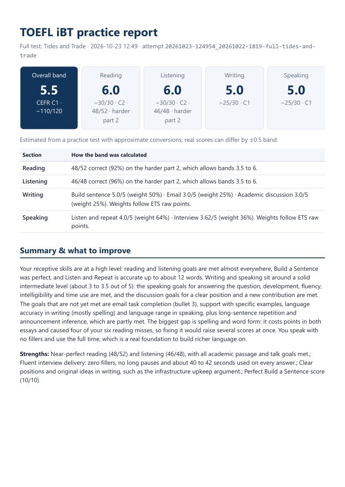
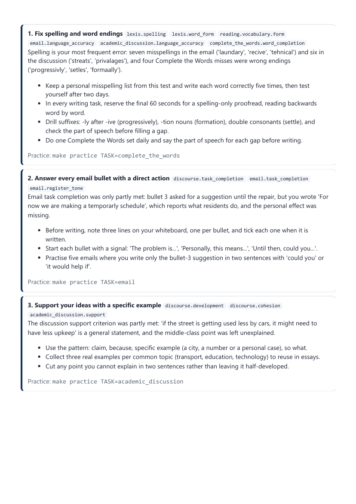
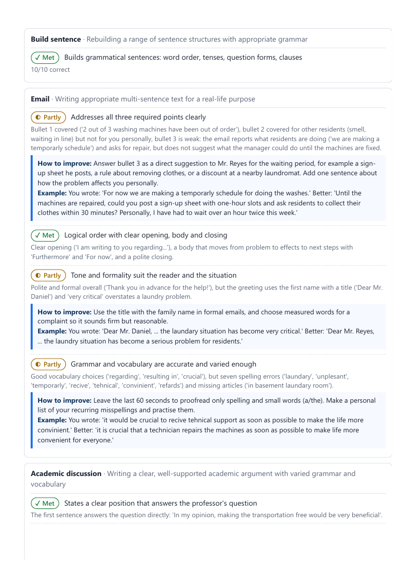
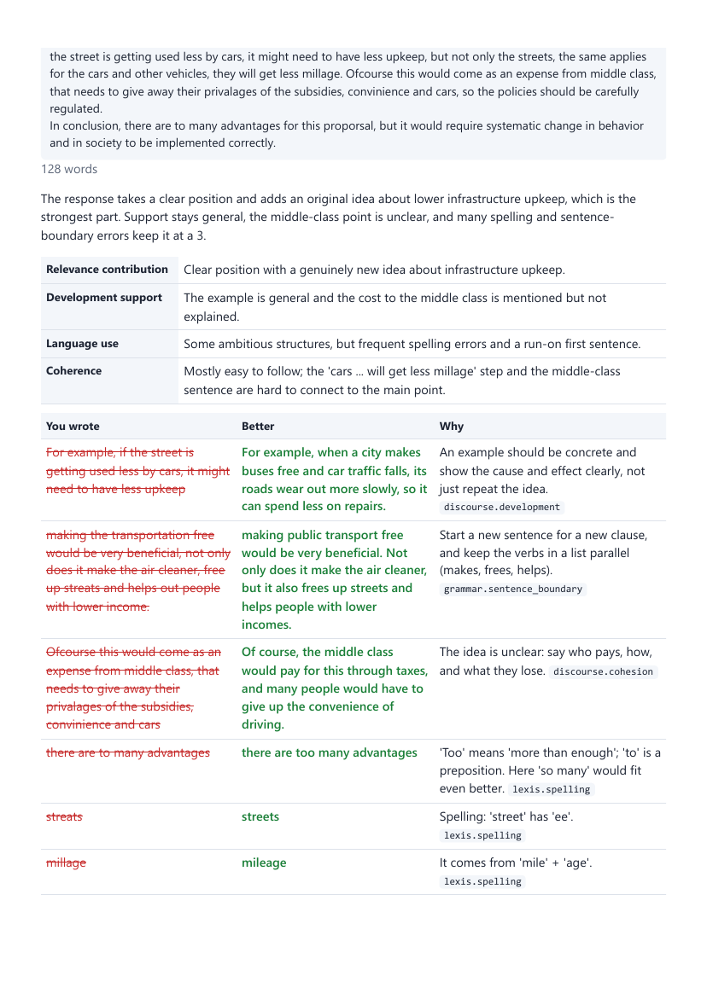

# TOEFL iBT practice generator (Claude-powered)

Generate full **TOEFL iBT** practice tests in the 2026 format, the same tasks as the **Home Edition**. Take them in a
local exam runner with timers, one-time audio and microphone recording. You then get an **estimated band
score and a PDF** that explains every mistake. Progress is tracked across attempts.

- **Claude** (through Claude Code skills) writes the test items, grades writing and speaking, and analyses your trends.
- **Python** handles everything that must be exact: timing, adaptive routing, answer keys, score maths, PDFs.
- **Your data stays local.** Attempts, recordings and reports go to `results/`.

> Unofficial. Not affiliated with or endorsed by ETS. TOEFL and TOEFL iBT are registered trademarks of ETS.
> All scores are estimates.

## Quick start

```bash
# needs Python 3.10+, Claude Code (`claude` on PATH, logged in), make, and Chrome/Edge for PDFs
make setup            # Python deps
make setup-speech     # optional but recommended: Whisper, so speaking can be graded
make sample           # take the bundled sample test right away
make test             # Claude generates a brand-new full test, then it opens in your browser
make test HE=1        # same, with Home Edition rules (check-in, full screen, no breaks)
```

When you press submit, grading runs automatically. The page shows your bands and links to
`results/<attempt>/report.pdf`.

No time to generate? `library/` already has ready-made tests (two full tests and an interview set). `make next`
opens the next full test you haven't taken, and their voices are rendered the first time you open them.

## The report

Every graded attempt gets a PDF report. The screenshots below are from a real first attempt at the library test
*Tides and Trade* (overall band 5.5, about 110/120). The report took about 3 minutes to produce after submitting.

| | |
|---|---|
| [](docs/images/report-summary.png) | [](docs/images/report-priorities.png) |
| **1. Scores and summary.** One band (1 to 6) per section and overall, with CEFR level and an estimated 0 to 120 score. A table shows how each band was calculated: raw score and adaptive route for Reading and Listening, weighted task scores for Writing and Speaking. Then a short summary and your strengths. | **2. What to improve.** Up to five priorities, ordered by how many points they cost. Each one quotes your actual mistakes, gives concrete drills and names the `make practice` command that targets it. In this attempt, spelling and word endings came first: they cost points in both essays and caused 4 of the 6 Reading misses. |
| [](docs/images/report-goals.png) | [](docs/images/report-corrections.png) |
| **3. Goals by task.** Every task type is checked against what it is designed to measure, marked Met, Partly or Not met (here 24 of 32 met, 8 partly). Reading and Listening goals come from your accuracy per question type. Writing and Speaking goals are rated by Claude with quoted evidence, a "How to improve" tip and a before/after example. | **4. Every answer, corrected.** All Reading and Listening questions with your answer, the correct one and why. Your essays and spoken transcripts are shown in full, with a rubric breakdown and a *You wrote / Better / Why* table. Each row is tagged with an error type, and those tags feed the trends. The report ends with an improved version of each essay and a model spoken answer. |

The Speaking part also lists, for each answer: words per minute, pauses, fillers and how much of the 45 seconds you
used, plus Listen and Repeat accuracy word by word. Reports are saved as `report.pdf` and `report.html` in
`results/<attempt>/`.

## Commands

| Command | What it does |
|---|---|
| `make test [LEVEL=hard] [HE=1]` | Generate a full adaptive test and open it |
| `make practice TASK=interview [COUNT=3] [LEVEL=hard]` | Practice one task type or section (`reading`, `email`, `academic_talk`, …) |
| `make weakest` | Practice set aimed at your most frequent error types |
| `make take ID=<test>` | Retake any saved test |
| `make serve` | Start page: pick, load or import a test, and see past results |
| `make grade ID=<attempt>` / `make regrade ID=…` | Grade (again); `ID=latest` works too |
| `make trends` | Progress PDF: band history, error trends, predicted score, 2-week study plan |
| `make study` | Study guide for writing and speaking: how your structure changed, a blueprint per task, linking words, key phrases, core errors, spelling list (`SECTION=writing` or `speaking` to narrow it) |
| `make list` | List your own and library tests |
| `make publish ID=<test> AUTHOR=you` | Copy a test into `library/` so others can use it (commit it or open a PR) |
| `make import FILE=x.json` / `make export ID=<test>` | Load or send a single test file |
| `make audio ID=<test>` | Re-render the voices for a test |
| `make check` | Offline self-test: validator, scoring, report, trends |

## How it works

```
make test ─► claude -p "/toefl-generate full"        .claude/skills/toefl-generate
               ├─ subagents write each section in parallel → tools/assemble.py
               ├─ tools/validate.py   (schema + semantic checks)
               ├─ blind-solver subagent answers every item; disagreements get rewritten
               └─ tools/tts.py         (edge-tts voices → tests/<id>/audio/*.mp3)
          ─► server/app.py  (local web exam, answer keys never sent to the browser)
               ├─ section timers, audio plays once, listening clock pauses during audio
               ├─ adaptive Reading/Listening: module 1 score → easier or harder module 2 (server-side)
               └─ microphone recordings → results/<attempt>/recordings/
          ─► submit → tools/pipeline.py
               ├─ transcribe.py   Whisper transcripts + fluency metrics (wpm, pauses, fillers)
               ├─ score.py        objective scoring + Listen & Repeat accuracy
               ├─ claude -p "/toefl-grade …"  rubric scores, quoted mistakes, fixes, priorities
               ├─ score.py        bands 1–6, CEFR, estimated 0–120  (conversion tables in the spec)
               └─ report.py       report.html → report.pdf (headless Chrome/Edge or Playwright)
make trends ─► claude -p "/toefl-trends" → results/trends/trends.pdf
```

**Single source of truth:** `spec/toefl-2026.yaml` holds the task types, counts, timings, voices, Home Edition
rules and score conversions. If ETS changes something, edit the spec.

### Task types covered
| Section | Tasks |
|---|---|
| Reading (adaptive) | Complete the Words · Read in Daily Life · Read an Academic Passage |
| Listening (adaptive) | Listen and Choose a Response · Conversation · Announcement · Academic Talk |
| Writing | Build a Sentence · Write an Email · Write for an Academic Discussion |
| Speaking | Listen and Repeat · Take an Interview (pre-recorded interviewer, 45 s, no prep) |

### Skills (in `.claude/skills/`)
- `toefl-generate`: item writer with a per-task quality guide and a blind-solver gate.
- `toefl-grade`: rater with project rubrics and a **fixed error taxonomy**, so trends can be compared over time.
- `toefl-practice`: targeted sets based on your history.
- `toefl-trends`: level prediction and a study plan.
- `toefl-study`: structure and phrase study guide for writing and speaking, built from all past responses.

They run headless through `claude -p` from the Makefile. You can also run them inside an interactive Claude Code session,
e.g. `/toefl-practice email`.

### Honest limitations
- Claude can't hear audio. Speaking is graded from the Whisper transcript plus timing metrics, so pronunciation is
  only approximated.
- Band and 0–120 conversions are approximations of ETS's published concordance. Treat ±0.5 band as normal.
- Generated items are checked automatically but are not ETS-calibrated. Use several tests and look at trends.

## Sharing tests

- `tests/` holds your own generated tests. It's git-ignored.
- `library/` holds shared tests. It's committed, and everyone sees these in the runner.
- `make publish ID=…` validates a test and copies it to `library/`; commit it and open a PR. Audio isn't committed,
  because everyone renders it locally: the runner renders missing voices when it starts (the opened test first, the
  rest in the background).
- From the start page: **Download** exports a test file, and **Load test from file…** imports one someone sent you.

## Results layout

```
results/
  20261022-153000_<test>/   test.json  responses.json  recordings/  transcripts.json
                            objective.json  grading.json  score.json  report.html  report.pdf
  index.jsonl               one line per graded attempt (bands, error-tag counts) → trends
  trends/                   trends.json  analysis.json  bands.png  errors.png  trends.pdf
  study/                    study_data.json  study.json  study.pdf  (make study)
```

## Development

- `?fast=10` on the runner URL compresses all timers 10×.
- `make check` runs the offline end-to-end test (no Claude, browser or Whisper needed).
- Environment overrides: `CLAUDE_BIN`, `CLAUDE_MODEL`, `WHISPER_MODEL` (default `small.en`), `CHROME_BIN`,
  `TOEFL_RESULTS_DIR`.
- Windows: install make with `winget install ezwinports.make` (or `choco install make`).
